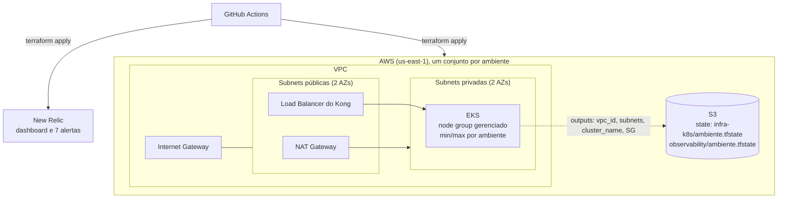

# fiap-mecanica-k8s-infra

Infraestrutura Kubernetes da Oficina Mecânica (Tech Challenge, Fase 3), provisionada com Terraform na AWS. É o **repositório 2 de 4**
e a base dos demais: a rede e o cluster EKS são criados aqui, e os repositórios do banco e da Lambda leem seus outputs pelo state remoto.

| Repositório | Papel |
|---|---|
| **fiap-mecanica-k8s-infra** (este) | VPC, cluster EKS com escalabilidade, dashboards e alertas de observabilidade |
| [fiap-mecanica-infra-dbs](https://github.com/FIAP-Mechanics/fiap-mecanica-infra-dbs) | RDS PostgreSQL gerenciado |
| [fiap-mecanica-lambda](https://github.com/FIAP-Mechanics/fiap-mecanica-lambda) | Function serverless de autenticação por CPF |
| [fiap-mecanica](https://github.com/FIAP-Mechanics/fiap-mecanica) | Microsserviços, API Gateway (Kong) e manifests Kubernetes |

## O que este repositório provisiona

- **Rede e cluster** (raiz): VPC com 2 AZs, subnets públicas e privadas, NAT, EKS (`aws_eks_cluster`) e node group gerenciado com
  escalabilidade (`node_min_size` / `node_max_size` por ambiente em `envs/`). No AWS Academy usa a `LabRole` existente.
- **Observabilidade** ([`observability/`](observability)): dashboard de 5 páginas (Negócio, APIs, Saúde e uptime, Kubernetes e Logs)
  e 7 condições de alerta no **New Relic**, por Terraform. Cobre latência das APIs, CPU e memória do Kubernetes, healthchecks e
  uptime, falhas no processamento de ordens de serviço e logs JSON com correlação (`request_id`, `trace.id`).
- **Scripts do laboratório** ([`scripts/`](scripts)): criação do bucket de state, secrets nos 4 repositórios, proteção de branches e
  derrubada do ambiente.

## Tecnologias

Terraform (>= 1.10, provider `aws ~> 5.80` e `newrelic ~> 3.100`), AWS (VPC, EKS, S3 para state com `use_lockfile`), New Relic, GitHub Actions.

## Diagrama da arquitetura



## Estrutura

```
.
├── eks.tf, network.tf, ...      # VPC e EKS
├── envs/                        # homologacao.tfvars e producao.tfvars
├── observability/               # dashboard e alertas do New Relic (state próprio)
│   └── envs/
├── scripts/
│   ├── aws-lab-bootstrap.sh     # bucket S3 do state (uma vez por conta)
│   ├── aws-lab-secrets.sh       # secrets/variables nos 4 repositórios
│   ├── github-governanca.sh     # proteção de main/homologacao e acesso do avaliador
│   └── aws-lab-down.sh          # destrói o ambiente (todos os repositórios)
└── .github/workflows/           # ci.yml e deploy.yml
```

## Como executar

Pré-requisitos: AWS CLI com as credenciais do Learner Lab ativas, Terraform >= 1.10 e GitHub CLI autenticado.

```bash
scripts/aws-lab-bootstrap.sh                 # imprime TF_STATE_BUCKET
terraform init \
  -backend-config="bucket=<bucket>" -backend-config="key=infra-k8s/homologacao.tfstate" \
  -backend-config="region=us-east-1" -backend-config="use_lockfile=true"
terraform apply -var-file=envs/homologacao.tfvars
```

Dashboards e alertas (precisam de `NEW_RELIC_API_KEY` e `NEW_RELIC_ACCOUNT_ID` no ambiente):

```bash
cd observability
terraform init -backend-config="bucket=<bucket>" -backend-config="key=observability/homologacao.tfstate" \
  -backend-config="region=us-east-1" -backend-config="use_lockfile=true"
terraform apply -var-file=envs/homologacao.tfvars -var="alert_email=voce@exemplo.com"
```

Validação sem credenciais: `terraform fmt -check && terraform init -backend=false && terraform validate`.

## CI/CD e deploy

- `ci.yml`: em pull request para `main` ou `homologacao`, roda `fmt -check`, `init -backend=false` e `validate` na raiz e em `observability/`.
- `deploy.yml`: um push em `homologacao` aplica o ambiente de **homologação**; um push em `main` aplica **produção** (Environment
  `producao` com aprovação). Aplica o EKS e depois `observability/` (este só se `NEW_RELIC_API_KEY` e `NEW_RELIC_ACCOUNT_ID` existirem).
- Secrets do Environment: `AWS_ACCESS_KEY_ID`, `AWS_SECRET_ACCESS_KEY`, `AWS_SESSION_TOKEN` (renovados a cada sessão do lab),
  `NEW_RELIC_API_KEY`, `NEW_RELIC_ACCOUNT_ID`. Variables: `TF_STATE_BUCKET`, `AWS_REGION`, `ALERT_EMAIL`.
  `scripts/aws-lab-secrets.sh <ambiente>` configura tudo nos 4 repositórios.

Regras do repositório: `main` e `homologacao` protegidas (sem commit direto, pull request obrigatório), configuradas por
`scripts/github-governanca.sh`. O usuário `soat-architecture` tem acesso de leitura.

### Ordem de provisionamento

Os repositórios se ligam por state remoto, então a ordem importa: **fiap-mecanica-k8s-infra** → fiap-mecanica-infra-dbs →
fiap-mecanica-lambda → fiap-mecanica. Para destruir, a ordem inversa: `scripts/aws-lab-down.sh <ambiente>` faz o caminho completo
(espera os quatro repositórios clonados lado a lado). O ambiente consome crédito do lab: destrua ao fim de cada sessão.

## Dockerfile

Não aplicável: este repositório contém apenas Terraform e scripts, sem imagem própria.

## Swagger/Postman das APIs

Este repositório não expõe API. As APIs ficam no repositório da aplicação:
[collection Postman](https://github.com/FIAP-Mechanics/fiap-mecanica/blob/main/postman/mecanica-completa.postman_collection.json)
e Swagger de cada serviço em `/swagger-ui.html`. A function de CPF está documentada em
[`openapi.yaml`](https://github.com/FIAP-Mechanics/fiap-mecanica-lambda/blob/main/openapi.yaml).

## Deploys ativos

| Ambiente | Cluster | Dashboard New Relic |
|---|---|---|
| Homologação | `mecanica-homologacao` | _preencher após o deploy_ |
| Produção | `mecanica-producao` | _preencher após o deploy_ |
